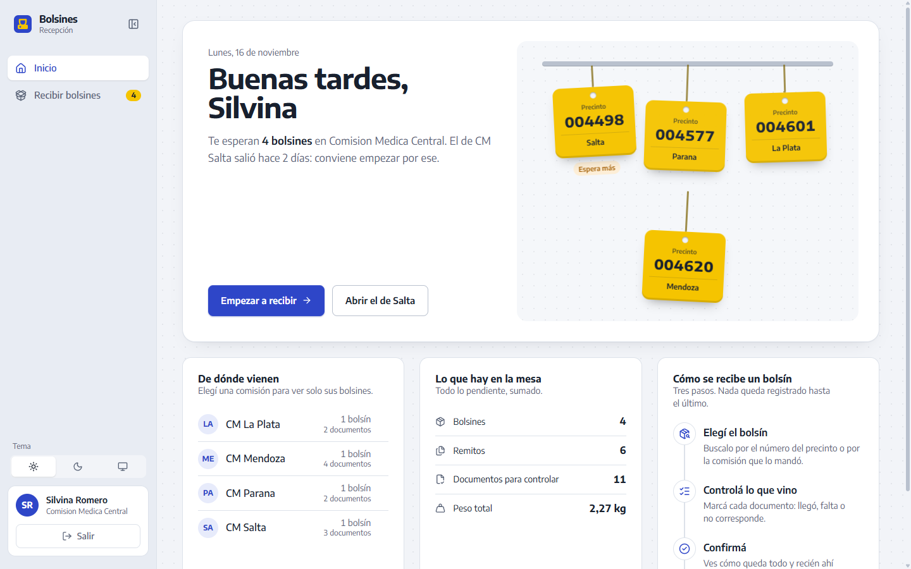
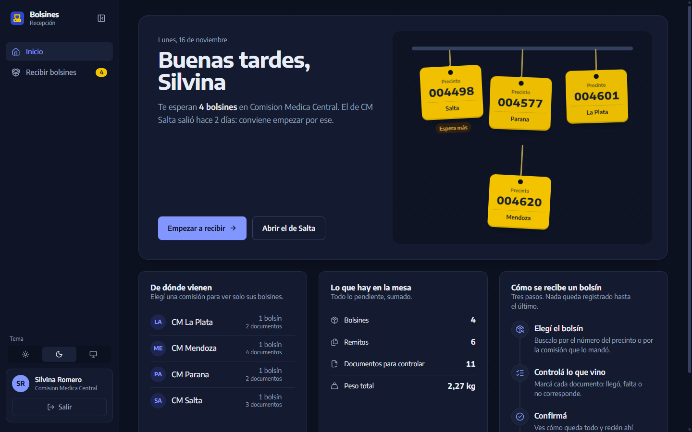
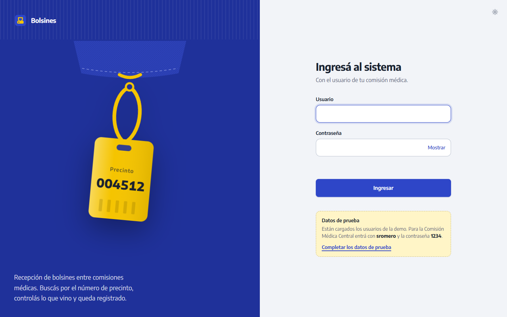
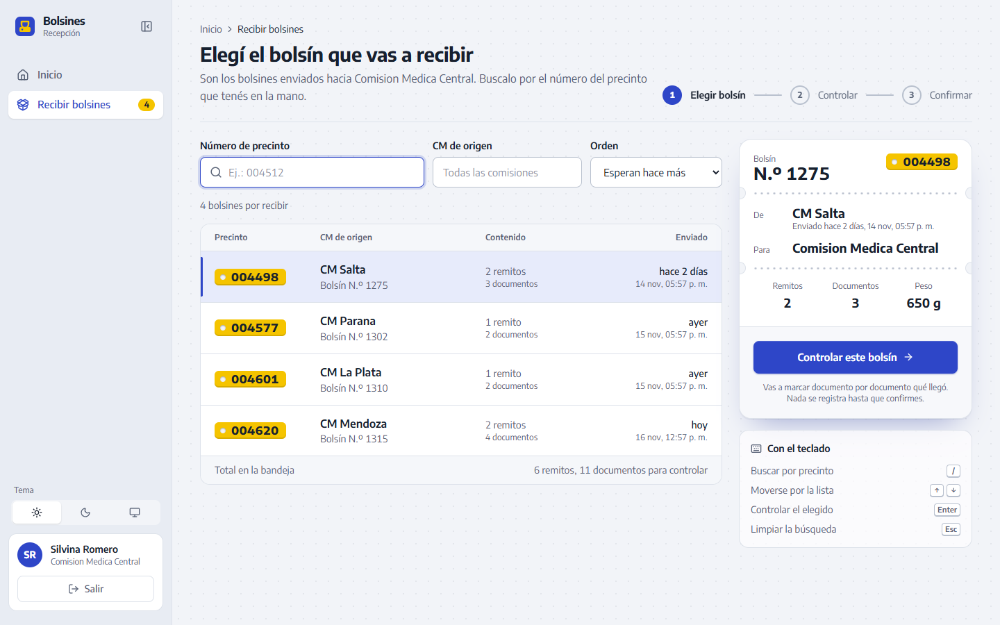
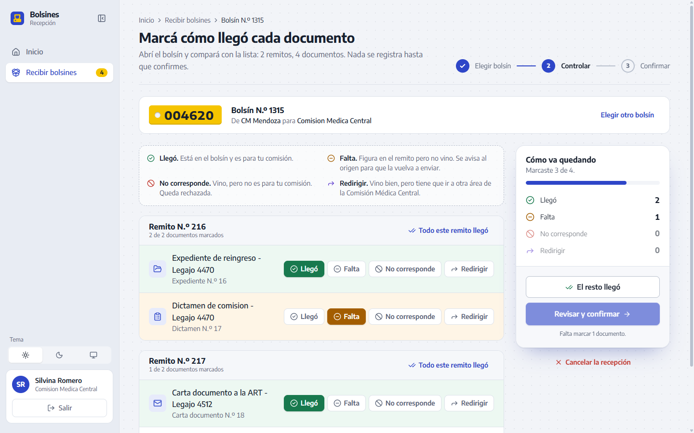
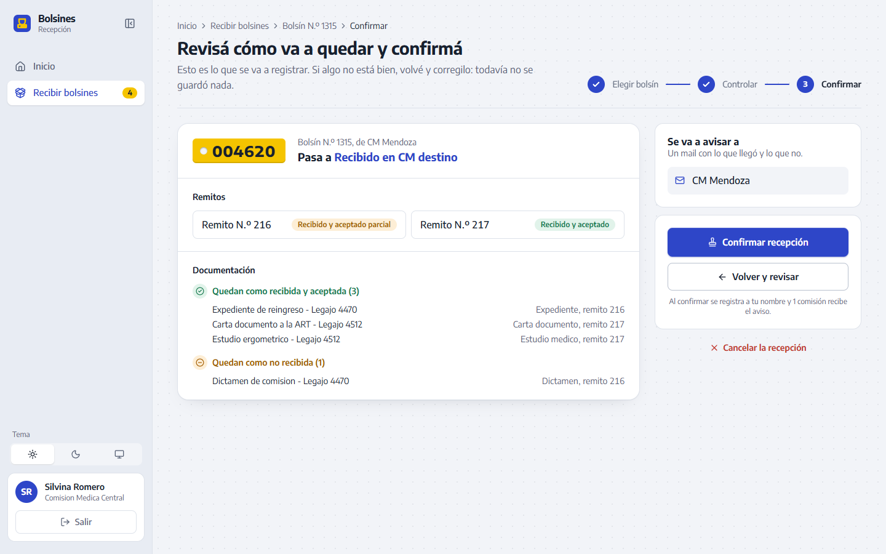
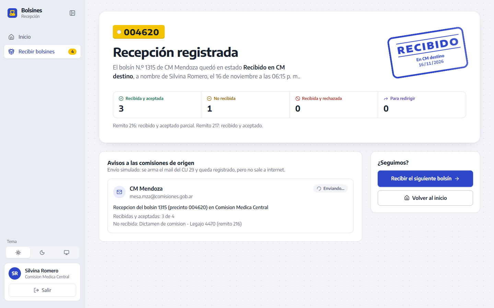
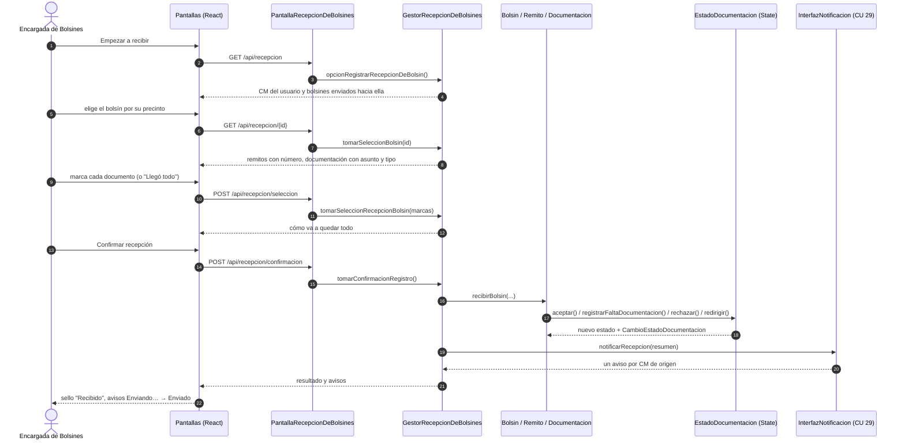
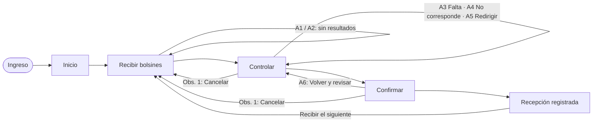

<div align="center">



<br />


**PPAI · Diseño de Sistemas de Información 2026 · UTN FRC · Grupo 4**<br />
CU 28 *Registrar recepción de bolsín* con el **patrón State** sobre `Documentacion`.

[Correr la app](#-correr-la-app) ·
[Recorrido](#-recorrido-de-la-demo) ·
[Arquitectura](#%EF%B8%8F-arquitectura) ·
[Flujo y llamadas](#-flujo-y-llamadas) ·
[Tests](#-tests) ·
[Equipo](#-equipo-y-dueños)

</div>

---

## 📦 Qué es

Las Comisiones Médicas (CM) se mandan documentación en **bolsines**: bolsas cerradas con un **precinto amarillo numerado**, que llevan remitos y, en cada remito, expedientes, dictámenes y estudios. Cuando un bolsín llega, la **Encargada de Bolsines** de la CM destino tiene que registrar qué vino.

La app resuelve ese momento de punta a punta:

1. **Elegir el bolsín** por el número de precinto que tiene en la mano.
2. **Controlar** documento por documento: *Llegó*, *Falta*, *No corresponde* o *Redirigir*.
3. **Confirmar** viendo antes cómo va a quedar todo.

Al confirmar, cada documentación cambia de estado (**patrón State**) y se avisa por mail a la CM de origen (**CU 29**, simulado).

<div align="center">


<br /><sub>Inicio en tema claro y oscuro. Los bolsines pendientes cuelgan como precintos; el que más espera está marcado.</sub>
</div>

---

## 🚀 Correr la app

> [!TIP]
> Solo hace falta **Java 21 y Maven**. No hay que instalar Node: Maven baja su propia copia y compila el front.

```bash
mvn spring-boot:run
```

Abrí **http://localhost:8080** e ingresá con **`sromero` / `1234`** (Comisión Médica Central). La pantalla de ingreso ofrece completar esos datos con un clic.

| Qué | Cómo |
|---|---|
| Correr todos los tests (Java + front) | `mvn test` |
| Generar el jar | `mvn package` y después `java -jar target/bolsines-0.1.0.jar` |
| Consola de la base | http://localhost:8080/h2-console · JDBC `jdbc:h2:file:./data/bolsines` · usuario `sa` sin contraseña |
| Volver los datos al estado inicial | con la app parada: `mvn spring-boot:run -Dspring-boot.run.arguments=--spring.jpa.hibernate.ddl-auto=create` (o borrar `data/`) |

<details>
<summary><b>🛠️ Desarrollar el front con recarga en caliente</b></summary>

<br />

Dos terminales: Spring sin compilar el front, y Vite, que le pasa `/api` a Spring (así la cookie de sesión viaja sola).

```bash
mvn spring-boot:run -Dskip.npm -Dskip.installnodenpm
```

```bash
cd frontend
npm install
npm run dev        # http://localhost:5173
```

Otros comandos del front: `npm test` (Vitest), `npm run lint` (oxlint), `npm run build` (deja el build en `target/classes/static`).

</details>


---

## 🧭 Recorrido de la demo

### Usuarios

Todos con contraseña `1234`. Hay un Encargado de Bolsines por comisión.

| Usuario | Encargado | Comisión |
|---|---|---|
| `sromero` | Silvina Romero | **Comisión Médica Central** (la única que puede redirigir) |
| `pgil` | Pedro Gil | CM Mendoza |
| `lpaz` | Laura Paz | CM Córdoba |
| `mrios` | Martín Ríos | CM Salta |
| `aluna` | Ana Luna | CM Paraná |
| `cvega` | Carlos Vega | CM La Plata |

### Qué usar en cada flujo (como `sromero`)

| En la app | Para mostrar |
|---|---|
| Precinto **004533** (CM Córdoba, 1 remito, 3 documentos) | **Flujo principal**: *Llegó todo* y confirmar |
| Precinto **004512** (CM Mendoza, 3 remitos, 5 documentos) | **A3**: marcar como *Falta* la "Radiografía de rodilla" (remito 214) |
| Precinto **004577** (CM Paraná, 1 remito, 2 documentos) | **A4**: marcar como *No corresponde* el "Expediente para CM Rosario" |
| Precinto **004498** (CM Salta, 2 remitos, 3 documentos) | **A5**: *Redirigir* el "Recurso de apelación" (para Asuntos Legales) |
| Precintos **004601** y **004620** | De repuesto, por si hay que repetir |
| Buscar el precinto **9999** | **A1**: "No hay ningún bolsín con el precinto 9999" |
| Escribir **Rosario** en *CM de origen* | **A2**: "No llegó ningún bolsín desde Rosario" |
| *Volver y revisar* en la confirmación | **A6**: vuelve al control con las marcas intactas |
| *Cancelar la recepción* | **Observación 1**: pide confirmación y no registra nada |

Además hay dos bolsines que **no** aparecen en la bandeja de la CMC: el 004640 va a CM Córdoba (con `lpaz` se ve, y ahí la opción *Redirigir* no existe) y el 004650 todavía está Cerrado.

### 🎤 Guion de la defensa

**Antes de empezar**, con la app parada, dejar la base como recién cargada:

```bash
mvn spring-boot:run -Dspring-boot.run.arguments=--spring.jpa.hibernate.ddl-auto=create
```

Tener abiertas tres cosas: la app (http://localhost:8080), la consola de H2 (http://localhost:8080/h2-console) y el código en el IDE. Los roles son una propuesta: ajústenlos.

| # | Quién | Qué se muestra | Dónde |
|---|---|---|---|
| 1 | Aznar | Ingreso con `sromero` y la bandeja con los 6 bolsines de la CMC. A1: buscar `9999`. A2: escribir `Rosario` en *CM de origen* | App |
| 2 | Agustín | **Flujo principal** con el **004533**: *Llegó todo*, *Revisar y confirmar*, *Confirmar recepción*. El aviso pasa de *Enviando…* a *Enviado* | App |
| 3 | Trini | **El patrón State en el código**: `Documentacion.aceptar` delega, `EstadoDocumentacion` prohíbe por defecto, `EnBolsinEnviado.aceptar` hace la transición, `RecibidaYAceptada` es final. Ver [el machete](docs/machete-patron-state.md) | IDE |
| 4 | Vale | **Persistencia**: en H2, `SELECT asunto, estado_actual FROM documentacion;` muestra cómo quedó la documentación del 004533. Explicar el ORM y el conversor del estado | H2 |
| 5 | Agustín | **A3** con el **004512**: *Falta* en la "Radiografía de rodilla". El remito 214 queda *aceptado parcial* y el aviso dice qué no llegó | App |
| 6 | Aznar | **A4** con el **004577** (*No corresponde*) y **A5** con el **004498** (*Redirigir*). **A6**: *Volver y revisar* mantiene las marcas; *Cancelar la recepción* no registra nada | App |
| 7 | Trini | En H2, el historial de un documento: cada cambio de estado con su fecha y su responsable | H2 |
| 8 | Vale | Reiniciar la app y mostrar que lo registrado sigue ahí | App |

Consulta para el paso 7:

```sql
SELECT d.asunto, c.estado, c.fecha_hora_inicio, c.fecha_hora_fin, e.apellido AS responsable
FROM cambio_estado_documentacion c
JOIN documentacion d ON d.id = c.documentacion_id
LEFT JOIN empleado e ON e.id = c.responsablece_id
WHERE d.asunto LIKE 'Radiograf%'
ORDER BY c.fecha_hora_inicio;
```

**Plan B:** tener la app corriendo en una segunda computadora, con la base recién reiniciada.

Documentos de apoyo: [machete del patrón State](docs/machete-patron-state.md) · [cambios para los diagramas](docs/cambios-para-diagramas.md) · [detalles de implementación para el informe](docs/detalles-de-implementacion.md).

### Las pantallas

<table>
<tr>
<td width="50%"><br /><b>Ingreso.</b> El precinto cuelga de la boca del bolsín. Error accesible, mostrar contraseña y vuelta a la pantalla pedida.</td>
<td width="50%"><br /><b>Recibir bolsines (pasos 1 a 5, A1, A2).</b> Búsqueda por precinto y CM de origen, tabla con la vista previa del rótulo del bolsín elegido y atajos de teclado.</td>
</tr>
<tr>
<td><br /><b>Controlar (pasos 6 a 8, A3, A4, A5).</b> Cada documento se marca con su opción explicada; al costado, cómo va quedando.</td>
<td><br /><b>Confirmar (pasos 9 y 10, A6).</b> Comprobante con el estado final de bolsín, remitos y documentación, y a quién se avisa.</td>
</tr>
<tr>
<td colspan="2" align="center"><br /><b>Recepción registrada (pasos 11 y 12).</b> Cae el sello, cada aviso pasa de <i>Enviando…</i> a <i>Enviado</i> y aparece "El mail ha sido enviado".</td>
</tr>
</table>

**Patrones de interfaz:** búsqueda con filtros, lista con selección (maestro-detalle), asistente por pasos, checklist por ítem con estado de color, diálogo de confirmación con resumen y mensaje de éxito con detalle. Además: tema claro y oscuro, barra lateral plegable, todo operable con teclado y respeto por *reducir movimiento*.

---

## 🏛️ Arquitectura

Es un **monolito**: una sola app Spring Boot que sirve la API y el front ya compilado. Los paquetes siguen los **estereotipos del modelo de análisis**, así el código se lee igual que los diagramas.

<div align="center">

</div>

```
src/main/java/ar/edu/utn/frc/dsi/bolsines/
├── boundary/        PantallaRecepcionDeBolsines, PantallaIngreso, GuardiaDeSesion   <<boundary>>
├── control/         GestorRecepcionDeBolsines                                       <<control>>
│   └── dto/         lo que viaja entre gestor y pantalla (records)
├── entity/          Bolsin, Remito, DetalleRemito, Documentacion, Estado…          <<entity>>
│   └── estado/      PATRÓN STATE: EstadoDocumentacion + 9 estados
├── repository/      repositorios de Spring Data
├── datos/           carga de los datos de la demo
└── servicio/        sesión y notificación del CU 29 (simulada)

frontend/src/
├── pantallas/       Ingreso, Inicio, Bandeja, Control, Confirmar, Registrada
├── componentes/     Marco (layout), Precinto, Perchero, FichaBolsin, Pasos, Dialogo, Tema…
├── api.ts           tipos iguales a los records de control/dto y las llamadas a la API
├── situaciones.ts   Llegó / Falta / No corresponde / Redirigir, con su explicación
└── rutas.tsx        rutas y guardia de sesión
```

**La pantalla del diagrama está en dos partes.** `PantallaRecepcionDeBolsines` (Java) recibe cada acción y se la pasa al gestor; las pantallas de React muestran lo que vuelve (`mostrarCM`, `mostrarNroRemito`, `solicitarConfirmacionRegistro`, `informarEjecucionExitosa`…). Ninguna de las dos decide nada: decide el gestor, y el gestor le pide a cada entidad que haga lo suyo.

**Patrón State en una línea.** `Documentacion` no pregunta en qué estado está: le delega cada operación (`aceptar`, `rechazar`, `redirigir`, `registrarFaltaDocumentacion`…) a su `EstadoDocumentacion` actual. Lo que un estado no redefine queda prohibido (`TransicionInvalidaException`). El estado se guarda por su nombre (`EstadoDocumentacionConverter`). Se usa **`Registrada`** como en la máquina de estados (en el diagrama de clases figura "Registrado").

| Capa | Tecnología |
|---|---|
| Front | React 19, Vite 8, TypeScript, React Router, Tailwind 4, Motion, lucide, Encode Sans |
| API y dominio | Java 21, Spring Boot 3.5 (Web, Validation, Data JPA con Hibernate) |
| Base | H2 en archivo (`data/bolsines.mv.db`) |
| Build | Maven con `frontend-maven-plugin` (baja Node, compila y testea el front) |

Más detalle para el informe: [`docs/detalles-de-implementacion.md`](docs/detalles-de-implementacion.md).

---

## 🔁 Flujo y llamadas

### API de la pantalla

| Método | Ruta | Llama a | Pasos del CU | Devuelve |
|---|---|---|---|---|
| `GET` | `/api/sesion` | `ServicioSesion.haySesion()` | | `{ logueado, modoDePrueba }` |
| `POST` | `/api/sesion` | `ServicioSesion.iniciarSesion()` | | 204, o 401 con el error |
| `DELETE` | `/api/sesion` | `ServicioSesion.cerrarSesion()` | | 204 |
| `GET` | `/api/recepcion` | `opcionRegistrarRecepcionDeBolsin()` | 1 a 4 | `InicioRecepcion` |
| `GET` | `/api/recepcion/{id}` | `tomarSeleccionBolsin(id)` | 5 y 6 | `DetalleBolsin` |
| `POST` | `/api/recepcion/seleccion` | `tomarSeleccionRecepcionBolsin(marcas)` | 7 a 9 | `ResumenRecepcion` |
| `POST` | `/api/recepcion/confirmacion` | `tomarConfirmacionRegistro()` | 10 a 12 | `ResultadoRecepcion` con los avisos |
| `DELETE` | `/api/recepcion/seleccion` | `cancelar()` | Obs. 1 | 204 |

- Sin sesión, todo `/api/recepcion/**` responde **401** (`GuardiaDeSesion`) y el front manda al ingreso.
- Si el gestor rechaza algo (`RecepcionException`), la API responde **409** con el mensaje en `detail`. La pantalla lo muestra sin perder lo marcado.
- `marcas` es `{ idDocumentacion: "RECIBIDA" | "FALTANTE" | "NO_CORRESPONDE" | "REDIRIGIR" }`. *Redirigir* solo lo acepta la CMC (A5).

### Secuencia del flujo principal



### Pantallas y caminos alternativos



> [!NOTE]
> **El mail está simulado**, como permite la cátedra. `NotificacionSimulada` arma cada aviso (a qué CM, a qué email, qué llegó y qué no), lo deja en el log como `[MAIL SIMULADO]` y lo devuelve. La pantalla muestra su envío. Para mandar mails de verdad alcanza con otra implementación de `InterfazNotificacion`; el gestor no cambia.

---

## ✅ Tests

```bash
mvn test                  # todo: JUnit (Java) y Vitest (front), desde Maven
cd frontend && npm test   # solo el front
```

| Suite | Qué prueba |
|---|---|
| `MaquinaEstadosDocumentacionTest` | Cada transición permitida y prohibida del patrón State |
| `GestorRecepcionDeBolsinesTest` | Flujo principal y A3 a A5 del gestor contra la base |
| `CargadorDatosDePruebaTest`, `CasoDeUsoCompletoTest`, `ServicioSesionTest` | Datos de la demo, CU completo y sesión |
| `PantallaRecepcionDeBolsinesTest` | Criterios de la T7 sobre la API: sesión, 401, datos del usuario, rechazos del gestor |
| `PantallaControlTest` | Criterios de la T8 con el gestor real: flujo principal, faltante, cancelar, redirigir fuera de la CMC |
| `filtro.test.ts` | Búsqueda por precinto y CM de origen (A1, A2) |
| `pantallas.test.tsx` | Ingreso, inicio, bandeja y selección |
| `recepcion.test.tsx` | Control, Redirigir solo para la CMC, resumen, *Volver y revisar*, cancelar y envío simulado |

---

## 👥 Equipo y dueños

Una rama por tarjeta desde `main` (`feature/t7-pantalla-bandeja`, `feature/t8-pantalla-control`…) y commits con la clave de Jira: `PB-10 feat(front): …`. Tablero: [PB en Jira](https://juanagustingarcia74.atlassian.net/browse/PB-1).

Nadie toca archivos de otro: si necesitás un cambio, se lo pedís al dueño.

| Archivos | Dueño | Tarjeta |
|---|---|---|
| `ComisionMedica`, `Empleado`, `Usuario`, `Sesion`, `TipoDocumentacion`, `repository/*`, `datos/*`, `application.properties` | Vale | T1 |
| `servicio/*` | Vale | T2 |
| `entity/estado/*` | Trini | T3 |
| `Documentacion`, `CambioEstadoDocumentacion`, tests de la máquina de estados | Trini | T4 |
| `control/*`, `Bolsin`, `Remito`, `DetalleRemito`, `CambioEstadoBolsin`, `Estado` | Agustín | T5, T6 |
| `boundary/*`, `frontend/*` | Aznar | T7, T8 |

<div align="center">
<sub>Hecho para la mesa de entradas: el precinto en la mano, la lista en la pantalla.</sub>
</div>
